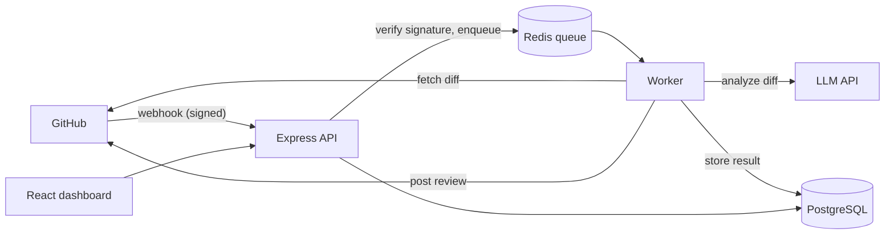

# Architecture

## Goal

When a pull request is opened or updated on a connected repository, post an AI-generated review on it, without making GitHub wait.

## Flow

## Key decisions

- **Respond to webhooks immediately.** GitHub expects a reply within seconds. The webhook handler only verifies the request and enqueues a job. All slow work happens in a worker.
- **Verify every webhook.** Anyone can send a POST to a public URL. The signature (HMAC-SHA256 over the raw body, using the webhook secret) proves a request came from GitHub.
- **A GitHub App, not a personal access token.** Apps get narrow permissions, act as their own identity, and are installed per repository.
- **Idempotency.** GitHub can deliver the same webhook twice, and a worker can retry. A review is keyed by repository, PR number and commit SHA, so the same commit is never reviewed twice.
- **Cost and size limits.** Diffs are capped, files like lockfiles are skipped, and the model call has a timeout, so one huge PR cannot run up a bill.
- **Secrets stay in environment variables.** The webhook secret, the app's private key and the model API key never go in the repo.

## Components

| Component | Responsibility |
|---|---|
| API | Receives webhooks, serves the dashboard's data |
| Queue | Holds jobs, retries failures |
| Worker | Fetches the diff, calls the model, posts the review |
| PostgreSQL | Repositories, reviews and their status |
| Dashboard | Lists reviews and their status |

## Open questions

- Which model, and what is the monthly spend limit?
- How should a very large PR be reviewed (by file, or a summary of the largest changes)?
- Should the bot review draft PRs?